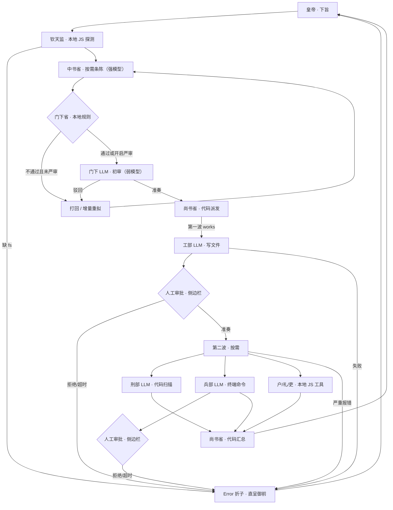

# dsh-tang-agent · 三省六部工作流

> 按需派发的多智能体朝议：中书起草、钦天监本地探测、门下先跑本地规则、尚书代码派发/汇总；工兵刑用 LLM，户礼吏直接跑 JS 工具。
> 侧边栏只做展示与操作；编排、持久化、工具与审批全部在 Host 完成。

- **插件名**：`dsh-tang-agent`
- **形态**：DSH Bundle（Host 真实编排 + Web Client 侧边栏）
- **编排接口**：`ctx.subagents.startActivation({ provider: 'spawn' })`
- **Prompt 来源**：`court/prompts.js` 纯 JS 固定文本（不依赖 Python）
- **真实工具**：`ctx.fs` / `ctx.subprocess` / `ctx.approval` / `ctx.tools`
- **UI 数据**：`/api/tang/*` + SSE 真实事件流
- **持久化**：DSH Storage kv；无 kv 时回退到 `$DSH_HOME/tang-dynasty-agents/runs.json`

---

## 一、按需朝议流程



- **钦天监**：纯 JS 探测 Host Service / provider / planned_tools，不调模型；结果直接拼进中书 Prompt。
- **中书**：只为真正需要的部门出条陈，不再强制六部齐全。
- **门下**：先跑本地规则（字数、危险词、代码块、礼部 args.path 等）；本地不通过且未开“严审”时直接打回，不调 LLM。
- **尚书**：派发和汇总都由代码完成，不再起独立 Agent。
- **工/兵/刑**：保留真实 LLM 子 Agent；**户/礼/吏**：直接调用本地 JS 工具，零 LLM。

### 一次运行需要多少 Agent

| 模式 | LLM 子 Agent 数（不含父会话/本地工具） |
| --- | --- |
| 快速问答 | 1（中书） |
| 单部直调 · 户/礼/吏 | 0（本地 JS） |
| 单部直调 · 工/兵/刑 | 1 |
| 完整朝议 · 按需 3 部，一次准奏 | 3（中书 + 门下 + 工部；户/礼本地） |
| 完整朝议 · 一次驳回 | 4（多一次门下或中书重拟） |

尚书、钦天监、户/礼/吏不再计入 LLM 子 Agent。另有 1 个不调模型的父会话承载子 Agent。

---

## 二、工具与执行方式

| 部 | 工具 | 执行方式 | 审批 |
| --- | --- | --- | --- |
| 工部 | `tang_works_write` / `tang_works_read` | LLM 子 Agent；`ctx.fs` 写/读 | 所有写入都需侧边栏审批 |
| 刑部 | `tang_justice_scan` | LLM 子 Agent；静态扫描 + 可选 `py_compile` | 只读 |
| 兵部 | `tang_war_run` | LLM 子 Agent；`ctx.subprocess` | 所有命令都需侧边栏审批 |
| 户部 | `tang_revenue_count` | **本地 JS**，直接统计 | 只读 |
| 礼部 | `tang_rites_doc` | **本地 JS**，直接读文档 | 只读 |
| 吏部 | `tang_personnel_assign` | **本地 JS**，直接分配角色 | 只读 |
| 钦天监 | 本地 `probeCapabilities()` | **本地 JS**，不注册 Agent 工具 | 只读 |

**安全边界**

- 所有文件路径限制在本次 run 的 `cwd` 内；越界直接拒绝。
- 所有工部写入、兵部命令都先进入侧边栏审批队列（`run.requestApproval()`）：pending → 人类点击允许/拒绝 → 才执行；拒绝或超时即打回。
- 若插件审批队列不可用，则回退到 DSH `ctx.approval.request()`；未获 `allowed-once` 一律失败（fail-closed）。
- 子 Agent 通过 `agent.ctx.tools.restrict` 只保留 `read`；`tang_*` 是 scoped 工具，只注入对应部。
- 额外 `tools.guard` 禁止子 Agent 再派生 `subagent`，避免递归与越权。
- 第一波工部失败或第二波部门严重报错时，尚书省立即熔断，不再强行汇总，把带 `Error` 的折子直呈皇帝。


---

## 三、消息与 UI

- 浏览器通过 `POST /api/tang/run` 下旨，返回 `runId`。
- `GET /api/tang/runs/:id/stream` 是 SSE，推送真实 run 快照：阶段、Agent 状态、流式文本、工具调用、审批结果、驳回次数。
- `GET /api/tang/runs` 列出历史；`POST /api/tang/runs/:id/cancel` 取消所有子 Agent。
- 面板显示每个子 Agent 的模型、Session 短 id、实时文本、真实工具调用与结果、失败原因。
- UI 不运行任何状态机；刷新后按 `runId` 恢复。

### 会话隔离

每次朝议都会通过 `ctx.agents.create()` 新建一个**独立父会话**，并 `attachSession` 到当前工作区；只有中书、门下、工/兵/刑是子 Agent；钦天监、尚书、户/礼/吏由 Host 本地代码执行。当前对话只收到 `tang_court` 的最终工具结果，不会混入子 Agent 的中间过程。父会话保留为新的 DSH 对话，插件卸载时才统一释放。

兵部命令统一使用 UTF-8 输出（PowerShell `$OutputEncoding` / Python `PYTHONIOENCODING`），中文路径与 stdout 不再出现 `?` 乱码。

---

## 四、模式

| 模式 | 行为 |
| --- | --- |
| 完整朝议 | 钦天监本地探测 → 中书按需起草 → 门下本地/LLM 审查 → 尚书代码派发 → 两波按需执行 → 代码汇总 |
| 单部直调 | 点名某部；户/礼/吏直接本地执行，工/兵/刑派 1 个 LLM Agent |
| 快速问答 | 单次 Agent 回答，不走朝议 |

连驳上限可在 UI 选择 2 或 3，默认 3；达到上限即封还御前。UI 的“严审”开关会让本地规则不通过的草案仍进入门下 LLM 复核，默认关闭以省 Token。

### 模型分层

插件配置可指定强弱模型；不配置时沿用 DSH 当前默认：

```yaml
config:
  models:
    strong: { provider: deepseek, model: deepseek-reasoner }
    weak: { provider: deepseek, model: deepseek-chat }
```

| 角色 | 默认层级 |
| --- | --- |
| 中书省 | strong |
| 门下省 | weak |
| 工/兵/刑 | strong |

`court/prompts.js` 的 system prompt 全部固定且不超过 150 字；动态圣旨/条陈只放在 user message，便于 Prompt Cache 命中。

### 自动更新

插件默认开启自动更新（仅对 **npm 安装** 生效）：

- 启动 15 秒后通过 DSH `pluginManager.listVersions()` 查询 `dsh-tang-agent` 的 npm 新版本；
- 有更新时调用 `pluginManager.updateBundle()`，由 DSH 完成卸载/安装/重启；
- **本地 `link:` / `file:` 安装自动跳过**，不会覆盖开发目录；
- 可通过插件配置关闭或调整：

```yaml
config:
  autoUpdate: false        # 关闭自动更新
  autoUpdateDelayMs: 15000 # 启动后延迟检查
  registry: https://registry.npmmirror.com/
```

自动更新失败不会影响朝议主流程，下次启动再试。

### 同一任务续旨

一次朝议完成后，面板会出现 **“续旨此案”** 按钮：

1. 点击后进入续旨状态（顶部显示“续旨 · runId 短号”）；
2. 输入新的增量圣旨，再点“传旨”；
3. Host 通过 `continueFrom` 复用上一案的父会话，并把上一案的中书草案、门下朱批、六部覆命摘要注入新 run 的 Prompt；
4. 若插件重启导致父会话句柄丢失，则新建父会话，但仍通过 `run.previous` 带上上一案上下文；
5. 点“改为新案”可退出续旨状态。

也可以直接调用工具：

```json
{"edict":"把上一案的报告补上预算章节","continue_from":"tang-xxxx"}
```


---

## 五、Host 工具

- `tang_court`：启动一次真实朝议；`wait: true` 时等待并返回完整报告，`wait: false` 时返回 `runId`。
- `tang_court_status`：按 runId 查看实时状态与工具调用。
- `tang_court_cancel`：取消运行中的朝议。

参数包含 `mode`（`full` / `single` / `quick`）、`max_rejections`、`ministry`。

---

## 六、安装与启用

已发布到 npm：<https://www.npmjs.com/package/dsh-tang-agent>

```powershell
# 方式一：在 DSH 插件页直接输入包名
dsh-tang-agent

# 方式二：本地目录（开发时）
D:\dshprogram\dsh-tang-agent

# 方式三：让 DSH Agent 调用 plugin_manager install_bundle
```

> 如果“添加插件”仍提示“未找到”，通常是安装源（中国大陆镜像）尚未同步新包；切换到 npm 官方源，或直接输入本地绝对路径。
> 本地开发时也可以继续使用目录方式，npm 包与本地目录指向同一套代码。

安装后左侧栏出现朱砂“唐”印，标题为 **三省六部工作流**。刷新页面（`Ctrl+R`）加载新 Client；若仍未更新，重启 DSH。

---

## 七、测试

```powershell
python test_tang_agents.py     # 14 个 Python 参考实现用例
node scripts/smoke.mjs         # 旧确定性引擎冒烟（兼容保留）
node scripts/check-client.mjs  # Client 装配 + idle 渲染检查
node scripts/build-client.mjs  # 重建 client.js
```

真实联调已跑通按需朝议：3 个 LLM 子 Agent（中书/门下/工部）+ 户部/礼部两个本地 JS 工具，尚书与钦天监零模型，结果由代码汇总。

---

## 八、已知限制

- 按需派发：中书未列出的部门不启动；户/礼/吏即使被列出也只用本地 JS，不产生 LLM 子 Agent。
- 本地 JS 工具失败（如文件不存在）记为 `blocked`，进入汇总的“需皇帝手动”，不触发 LLM 部门熔断；LLM 子 Agent `failed` 才熔断并直呈 Error 折子。
- 第一波失败或第二波 LLM 部门严重报错时会**熔断**，不再强行汇总，直接生成 Error 折子呈报皇帝。
- 审批由插件的 `approval/request` answerer 推到侧边栏；拒绝或超时即打回。
- 本地规则可能误报（如礼部缺少 `args.path`）；打开“严审”可让门下 LLM 复核。
- 浏览器视觉未截图验证；已做 slot 注册、SSE 接口与 idle 渲染检查。

---

## 九、License

MIT。唐印与图标为原创绘制。
