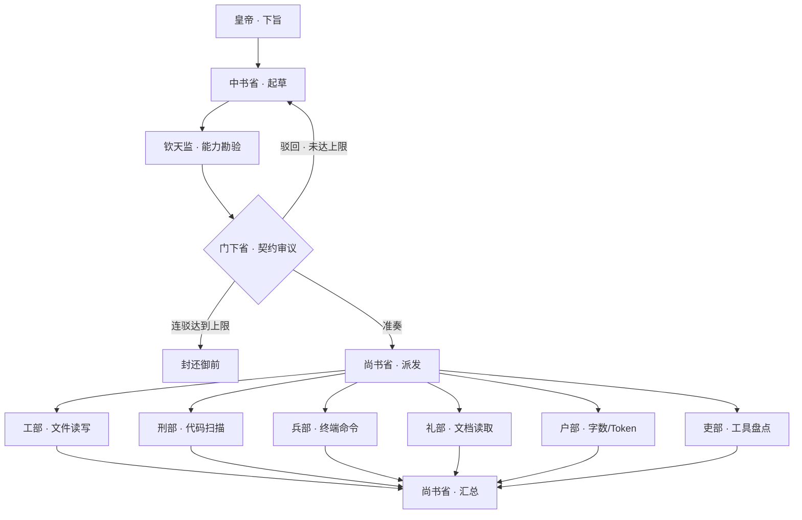

# dsh-tang-agent · 三省六部工作流

> 真正的多智能体朝议：中书起草、钦天监勘验、门下封驳、尚书派发，六部各自派生独立子 Agent 并调用真实工具。
> 侧边栏只做展示与操作；编排、持久化、工具与审批全部在 Host 完成。

- **插件名**：`dsh-tang-agent`
- **形态**：DSH Bundle（Host 真实编排 + Web Client 侧边栏）
- **编排接口**：`ctx.subagents.startActivation({ provider: 'spawn' })`
- **Prompt 来源**：`prompts.py` 每次运行时动态读取（Python → JSON）
- **真实工具**：`ctx.fs` / `ctx.subprocess` / `ctx.approval` / `ctx.tools`
- **UI 数据**：`/api/tang/*` + SSE 真实事件流
- **持久化**：DSH Storage kv；无 kv 时回退到 `$DSH_HOME/tang-dynasty-agents/runs.json`

---

## 一、真实朝议流程



每个角色都是一个**独立 Agent 实例**（独立 Session、独立 System Prompt、独立工具面），
不是浏览器里的本地状态机。

### 一次运行需要多少 Agent

| 模式 | 子 Agent 数（不含承载父会话） |
| --- | --- |
| 快速问答 | 1（中书） |
| 单部直调 | 1（指定部） |
| 完整朝议 · 一次准奏 | 11（中书 + 钦天监 + 门下 + 尚书派发 + 六部 + 尚书汇总） |
| 完整朝议 · 一次驳回 | 14 |
| 完整朝议 · 连驳 3 次（封还） | 17 |

另有 1 个不调用模型的“朝议父会话”用于承载子 Agent；也可复用当前会话作为父。

---

## 二、六部真实工具

| 部 | 工具 | 实际行为 | 审批 |
| --- | --- | --- | --- |
| 工部 | `tang_works_write` / `tang_works_read` | `ctx.fs` 写/读工作区文件 | 业务路径需审批；`tang-artifacts/` 沙箱免审批 |
| 刑部 | `tang_justice_scan` | 递归扫描危险模式 + `python -m py_compile`（argv 直传，无 shell 拼接） | 只读，无需审批 |
| 兵部 | `tang_war_run` | `ctx.subprocess` 执行命令，30s 默认超时 | 精确只读白名单免审批；其余需审批 |
| 户部 | `tang_revenue_count` | 统计字符 / CJK / 拉丁词 / 行数 / 近似 Token | 只读 |
| 吏部 | `tang_personnel_tools` | `ctx.tools.schemas(agent)` 列当前可见工具 | 只读 |
| 礼部 | `tang_rites_doc` | 读取文档并提取标题、行数、摘要 | 只读 |
| 钦天监 | `tang_qintian_probe` | 探测 Host Services、工具面、子 Agent provider、planned_tools | 只读 |

**安全边界**

- 所有文件路径限制在本次 run 的 `cwd` 内；越界直接拒绝。
- 业务写入/命令必须调用 `ctx.approval.request()`，未获 `allowed-once` 一律失败。
- 子 Agent 通过 `agent.ctx.tools.restrict` 只保留 `read`；`tang_*` 是 scoped 工具，只注入对应部。
- 额外 `tools.guard` 禁止子 Agent 再派生 `subagent`，避免递归与越权。
- 当前会话审批提示被禁用时，业务写入会被自动拒绝；这是 DSH 的 fail-closed 行为，不是插件绕过。
- `tang-artifacts/` 是演示沙箱，允许免审批落盘；生产业务文件请走审批。

---

## 三、消息与 UI

- 浏览器通过 `POST /api/tang/run` 下旨，返回 `runId`。
- `GET /api/tang/runs/:id/stream` 是 SSE，推送真实 run 快照：阶段、Agent 状态、流式文本、工具调用、审批结果、驳回次数。
- `GET /api/tang/runs` 列出历史；`POST /api/tang/runs/:id/cancel` 取消所有子 Agent。
- 面板显示每个子 Agent 的模型、Session 短 id、实时文本、真实工具调用与结果、失败原因。
- UI 不运行任何状态机；刷新后按 `runId` 恢复。

---

## 四、模式

| 模式 | 行为 |
| --- | --- |
| 完整朝议 | 中书 → 钦天监 → 门下（可多轮）→ 尚书 → 六部并发 → 尚书汇总 |
| 单部直调 | 皇帝点名某部，跳过三省，直接派生该部 Agent |
| 快速问答 | 单次 Agent 回答，不走朝议 |

连驳上限可在 UI 选择 2 或 3，默认 3；达到上限即封还御前，不再派发六部。

---

## 五、Host 工具

- `tang_court`：启动一次真实朝议；`wait: true` 时等待并返回完整报告，`wait: false` 时返回 `runId`。
- `tang_court_status`：按 runId 查看实时状态与工具调用。
- `tang_court_cancel`：取消运行中的朝议。

参数包含 `mode`（`full` / `single` / `quick`）、`max_rejections`、`ministry`。

---

## 六、安装与启用

本机已安装并启用。重新安装：

```powershell
# 在 DSH 插件页选择目录 D:\dshprogram\dsh-tang-agent
# 或让 DSH Agent 调用 plugin_manager install_bundle
```

安装后左侧栏出现朱砂“唐”印，标题为 **三省六部工作流**。刷新页面（`Ctrl+R`）加载新 Client；若仍未更新，重启 DSH。

---

## 七、测试

```powershell
python test_tang_agents.py     # 14 个 Python 参考实现用例
node scripts/smoke.mjs         # 旧确定性引擎冒烟（兼容保留）
node scripts/check-client.mjs  # Client 装配 + idle 渲染检查
node scripts/build-client.mjs  # 重建 client.js
```

真实多智能体联调已实际跑通：一次完整朝议派生 14 个子 Agent，六部均产生真实工具调用记录（见 `tang-artifacts/` 与运行起居注）。

---

## 八、已知限制

- 六部并发时存在数据依赖：户部可能在工部报告落盘前读取，出现 `FS_NOT_FOUND`。建议后续增加“工部先行 / 户部后置”的依赖波次。
- 审批提示在本会话被禁用，业务路径写入/非白名单命令会被自动拒绝；演示请使用 `tang-artifacts/` 沙箱。
- Windows 控制台中文编码可能显示为乱码；文件本身为 UTF-8。可用 `-Encoding utf8` 写文件后再读校验。
- 浏览器视觉未截图验证；已做 slot 注册、SSE 接口与 idle 渲染检查。

---

## 九、License

MIT。唐印与图标为原创绘制。
