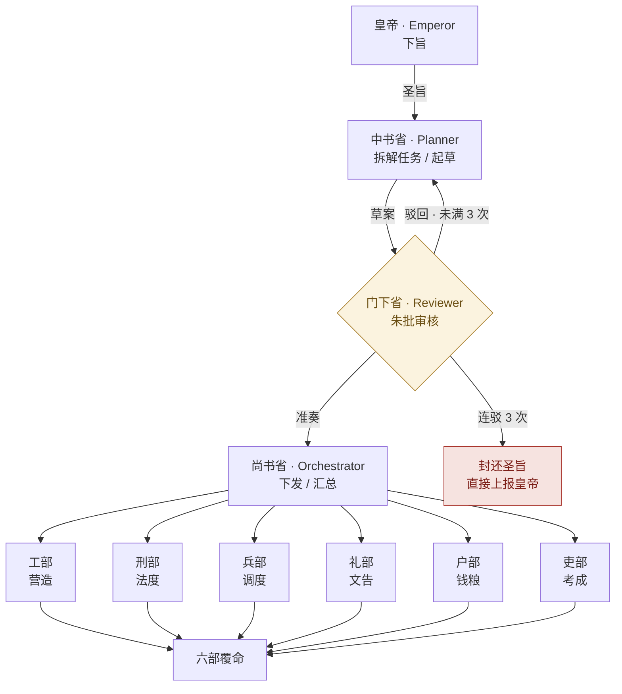
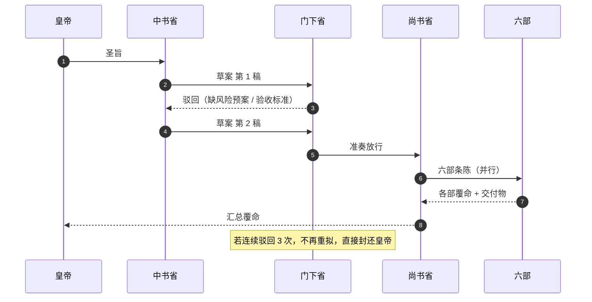

# Tang-Dynasty-Agents · 三省六部

> 一道圣旨如何变成六部覆命？  
> 把唐代三省六部制做成 DSH 插件：中书起草、门下封驳、尚书下发、六部并行，
> 侧边栏实时展示「圣旨流转」，并内置连驳三次自动上报皇帝的防死锁机制。

- **插件名**：`tang-dynasty-agents`
- **显示名**：Tang-Dynasty-Agents · 三省六部
- **形态**：DSH Bundle（Host 工具 + Web Client 侧边栏面板）
- **依赖**：无第三方运行时依赖；Host 半部只用 Node 内置能力
- **默认行为**：确定性沙盘，不访问网络、不调用模型，可离线演示与测试

---

## 一、架构



### 一次完整的流转



### 防死锁

| 情形 | 行为 |
| --- | --- |
| 第一次驳回 | 记录驳议，退回中书省修订（`revising`） |
| 第二次驳回 | 继续修订，连驳计数 +1 |
| 第三次驳回 | **立即进入 `escalated`**：封还圣旨、停止下发六部、上报皇帝 |
| 皇帝改旨 | 重新下旨即重置连驳计数与整条状态机 |

这条规则在 Python 与 JS 两套实现中完全一致，并有专门的测试用例覆盖。

---

## 二、文件结构

```
tang_dynasty_agents/
├── README.md                 # 本文件：架构图、安装、激活与使用说明
├── package.json              # DSH Bundle 清单（Host 入口 + Client 入口 + 图标 + locale）
├── cordis.patch.yml          # 向 DSH 组合插入插件行
├── index.js                  # Host 半部：注册 tang_court 工具
├── engine.js                 # JS 状态机（Host 与侧边栏共用，单一事实来源）
├── client.js                 # 构建产物：浏览器模块（由 scripts/build-client.mjs 生成）
├── icon.svg                  # 原创朱砂“唐”印图标
├── locale/
│   ├── zh.json               # 插件管理页中文标题/描述
│   └── en.json               # 英文标题/描述
├── prompts.py                # 三省六部古风 System Prompts + 六部工具清单
├── graph.py                  # Python 参考实现：状态机、审计轨迹、CLI
├── test_tang_agents.py       # Python 单元测试（含连驳三次上报用例）
├── ui/
│   ├── panel.js              # React 侧边栏面板（无 JSX，注册 sidebar.panellist + main）
│   ├── styles.js             # 仅使用 --dsw-alias-* 主题令牌的样式
│   └── icons.js              # 唐印与六部字符图标
└── scripts/
    ├── build-client.mjs      # 把 engine.js + ui/*.js 拼成 client.js
    └── smoke.mjs             # Node 冒烟测试（与 Python 行为对齐）
```

**两份实现，一套语义**：

- `graph.py` 是可读、可测试的参考实现，适合接入真实 LLM；
- `engine.js` 是侧边栏与 Host 工具实际运行的实现；
- 两者的阶段名、字段名、驳回上限、审计动作保持一致；限期与度支的
  数值也使用同一种 djb2 种子派生，同一道圣旨在 CLI 与侧边栏中数字一致；
- `test_tang_agents.py` 与 `scripts/smoke.mjs` 分别守护这两种运行时。

---

## 三、安装到 DSH

### 方式 A：插件管理页（推荐）

1. 打开 DSH → **设置 → 插件**；
2. 选择 **安装本地插件 / Install bundle**；
3. 选择目录：`D:\dshprogram\tang_dynasty_agents`；
4. 安装完成后，在插件列表中找到 **Tang-Dynasty-Agents · 三省六部**，确认开关为开启；
5. 左侧栏底部会出现朱砂色 **“唐”** 印章图标。

### 方式 B：让 DSH Agent 安装

对 DSH 说：

> 把 `D:\dshprogram\tang_dynasty_agents` 作为 bundle 安装到当前 profile。

Agent 会调用 `plugin_manager` 的 `install_bundle`，`target` 指向该绝对路径。
安装结果为 `applied` 即已生效；若显示 `restart-required`，重启 DSH 即可。

### 方式 C：CLI（仅当 `dsh` 已在 PATH 中）

```powershell
dsh plugin --profile desktop add D:\dshprogram\tang_dynasty_agents
```

若提示找不到 `dsh` 命令（DSH Desktop 默认不一定写入 PATH），请使用方式 A 或 B。

### 激活与打开

- 侧边栏左列（全局面板图标区）→ 点击 **唐** 印；
- 中央主面板会打开「Tang-Dynasty-Agents · 三省六部」；
- 若图标未出现：
  1. 设置 → 插件，确认插件已启用；
  2. 刷新页面（`Ctrl + R`）；
  3. 仍不生效则重启 DSH（新装的 Client 模块通常需要一次页面刷新）。

> 侧边栏入口注册在 `sidebar.panellist`（`id: tang`），主面板注册在 `main`
> （`key: tang`）。两者 id 必须一致，这是 DSH 面板配对的约定。

---

## 四、侧边栏怎么用

1. **下旨**：在「皇帝 · 下旨」输入框写清目标、期限、钱粮、禁忌；
   也可以点三条例样圣旨，或按 `Ctrl + Enter` 传旨。
2. **看流转**：顶部五段式流程条会依次点亮
   `皇帝 → 中书省 → 门下省 → 尚书省 → 六部`。
3. **看朱批**：
   - 默认「自动」模式：门下省会先驳回第 1 稿（缺风险与验收），
     中书省自动修订，第 2 稿准奏；
   - 勾选「亲批」：面板停在门下省，由你点 **准奏** 或 **驳回**；
     驳回可写缘由，连驳 3 次会触发封还御前。
4. **看六部**：六张部衙卡片并行推进，覆命后显示交付物与度支指标。
5. **看起居注**：右侧时间线记录每一步（下旨、草拟、驳回、修订、准奏、接旨、覆命、汇总），
   点「复制起居注」可导出纯文本。
6. **连驳演练**：点「连驳演练」，门下省将连续驳回三次，
   可直接观察「封还御前」横幅与红色流程节点。
7. **节奏**：慢 / 标准 / 快三档；「重置」只清空沙盘，保留已输入的圣旨。

面板状态保存在组件内存，最近一次圣旨写入 `localStorage`（键
`tang-dynasty-agents:last-edict`），不会上传到任何服务器。

---

## 五、六部职守与独立工具

| 部 | 职守 | System Prompt 要点 | 工具 |
| --- | --- | --- | --- |
| 工部 | 营造、工程、器物、代码与交付物 | 只管造得出、造得成、造得久 | `draw_blueprint` / `estimate_works` |
| 刑部 | 律令、合规、风险审查与争端处置 | 只断可不可为、如何避险 | `check_statutes` / `assess_risk` |
| 兵部 | 调度、排期、人手、应急与保障 | 办得动、接得住、乱不了 | `muster_route` / `schedule_guard` |
| 礼部 | 文告、仪注、对外沟通与教化 | 说得清、传得正、不失礼 | `draft_notice` / `arrange_rites` |
| 户部 | 钱粮、预算、成本与账目 | 钱够不够、从哪来、怎么记 | `budget_ledger` / `audit_grain` |
| 吏部 | 人事、差遣、考成与激励 | 人岗相配、责权分明、赏罚有据 | `assign_officials` / `appraise_merit` |

每个部的 prompt 都包含：职守、工具、JSON 奏报格式、戒律。详见
[`prompts.py`](prompts.py)；每部只看到自己的条陈与工具，互不越权。

---

## 六、Host 工具：`tang_court`

插件激活后，模型可调用：

```json
{
  "edict": "着工部于三月内修缮东市水渠，户部拨钱粮，刑部核验工料，吏部考成，礼部告示百姓。",
  "always_reject": false
}
```

返回完整的起居注、草案、朱批与六部交付物。把 `always_reject` 设为 `true`
即可在对话里复现「连驳三次，封还御前」的防死锁路径。

适合用在：

- 需要先“起草 → 审核 → 执行 → 汇总”的复杂任务；
- 想在执行前强制一次独立复核；
- 想演示多 Agent 编排，但又不想真实调用模型/消耗额度。

---

## 七、Python 参考实现

```powershell
cd D:\dshprogram\tang_dynasty_agents

# 跑一道圣旨（默认会经历一次驳回与修订）
python graph.py "着工部于三月内修缮东市水渠，户部拨钱粮，刑部核验工料。"

# 演练连驳三次、封还御前
python graph.py "着户部清查天下仓廪。" --reject-all

# 输出完整 JSON 轨迹
python graph.py "着礼部筹办今岁科考。" --json
```

嵌入自己的程序：

```python
from graph import TangCourt

run = TangCourt(max_rejections=3).run("着工部修缮东市水渠。")
print(run.summary())
print(run.to_dict())        # 可直接 json.dumps / 入数据库
```

替换为真实 LLM 时，只需提供与默认实现同签名的三个对象：

```python
TangCourt(
    planner=MyLlmPlanner(),     # draft(edict, revision, previous) -> Draft
    reviewer=MyLlmReviewer(),   # review(draft, edict, attempt) -> Review
    executor=MyLlmExecutor(),   # execute(order, edict) -> MinistryResult
)
```

状态机、防死锁与审计轨迹全部复用，不需要改动 `graph.py`。

---

## 八、测试与构建

```powershell
cd D:\dshprogram\tang_dynasty_agents

# Python：14 个用例，覆盖默认驳回、连驳三次上报、亲批、序列化、prompt 完整性
python test_tang_agents.py -v

# JS：主机工具与侧边栏共用的状态机
node scripts/smoke.mjs

# 修改 ui/ 或 engine.js 后重新生成 client.js
node scripts/build-client.mjs
```

`test_tang_agents.py` 中的关键用例：

- `test_default_flow_rejects_once_then_completes`：默认一次驳回后完成六部覆命；
- `test_three_rejections_escalate_to_emperor`：连驳 3 次进入 `escalated`，且不再下发六部；
- `test_approved_first_time_skips_revision`：一次准奏的顺利路径；
- `test_each_executor_result_uses_own_tools`：六部各自产出独立度支指标；
- `test_ministry_prompt_names_duty_and_tools`：每部 prompt 含本部名称与工具。

---

## 九、设计说明与限制

- **为什么是“沙盘”**：插件默认不调用 LLM，保证离线可运行、结果可复现、测试稳定。
  `prompts.py` 与三个可替换接口（planner / reviewer / executor）已经为真实模型留好位置。
- **为什么 JS 与 Python 双实现**：DSH 侧边栏运行在浏览器，无法直接执行 Python；
  `graph.py` 负责“可读、可测、可移植”的参考语义，`engine.js` 负责“在 DSH 里真的跑起来”。
  两者由各自的测试守护，字段与阶段保持同名。
- **主题**：面板只用 `--dsw-alias-*` 令牌，亮/暗主题自动适配；朱砂色仅用于印章与朱批，
  属于作品色。
- **数据**：不落库、不上传；仅最近一次圣旨写入浏览器 `localStorage`。
- **安全**：Host 工具只做本地确定性计算，不读文件、不联网、不改其他插件状态。

---

## 十、License

MIT。印章与图标为原创绘制；古风文案为本项目原创。
